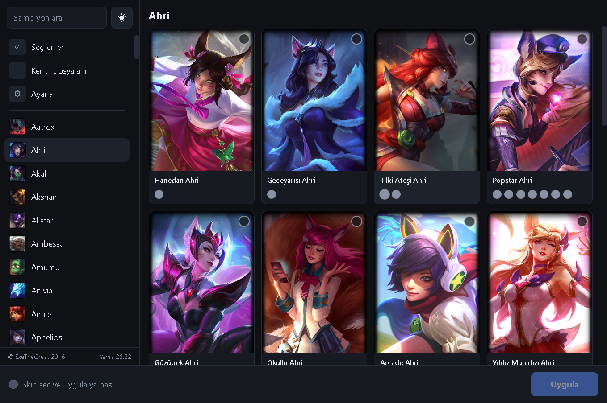

# EXE Skin Manager

League of Legends için sade bir skin yöneticisi: şampiyonu seç, skin'e tıkla, **Uygula**'ya bas.



## Özellikler

- **Tüm şampiyonlar ve skin'ler**: liste internetten gelir ve kendiliğinden yenilenir. Skin yalnızca seçilince iner, bir kez indiyse tekrar inmez.
- **Renk paketleri ve formlar**: kartın altındaki noktalardan seçilir; rengin adı üzerine gelince görünür.
- **13 dil**: arayüz, şampiyon/skin/renk adları ve hata mesajları (Türkçe, İngilizce, Almanca, Fransızca, Rusça, Arapça, Lehçe, İspanyolca, Çince, Portekizce, Endonezce, Japonca, Hintçe). Uygulama her açılışta Türkçe başlar.
- **Kendi dosyaların**: `.fantome`, `.zip`, `.wad`, `.modpkg` dosyaları ya da klasörler eklenir; tiki kaldırınca silinmez, yalnızca devre dışı kalır. İçerik istenen klasöre çıkarılabilir.
- **Güvenlik uyarısı**: oyun motoru bir modu "skinhack" olarak işaretlerse (bu durumda oyun tüm modları kapatır) hangi mod olduğunu söyler.
- **Sürüm bildirimi**: skin motorunun yeni sürümü ve oyunun güncel yaması resmî kaynaklardan denetlenir; hiçbir şey kendiliğinden kurulmaz.
- Aydınlık/karanlık tema, oyun klasörünü elle seçme, tek tıkla kurulum.

## Kurulum

1. [Releases](../../releases) sayfasından `EXE-Skin-Manager-Setup-<sürüm>.exe` dosyasını indir ve çalıştır (yönetici izni gerekmez).
2. SmartScreen uyarısı çıkarsa **Ek bilgi → Yine de çalıştır** (uygulama imzalı değildir).

**Gereksinimler:** Windows 10/11 (64 bit), League of Legends, internet bağlantısı, Visual C++ Yeniden Dağıtılabilir (2015–2022, x64), Microsoft Edge WebView2. Ayrıntılar ve sorun çözme için [BENIOKU.txt](BENIOKU.txt).

## Kullanım

1. Soldan bir şampiyon, sağdan bir skin (ve istersen renk paketi) seç.
2. **Uygula**'ya bas; "Skinler hazır" yazınca oyuna gir. Oynarken uygulama açık kalmalı.
3. Seçimi değiştirirsen **Güncelle**, işin bitince **Durdur**.

## Geliştirme

```bash
npm install
npm start
```

- `motor/` klasörü (üçüncü taraf ikili dosyalar) depoda **yoktur**. Geliştirmek için kurulu uygulamadaki `%LOCALAPPDATA%\Programs\skin-yonetici\resources\motor` klasörünü proje köküne kopyala.
- VS Code terminalinde `ELECTRON_RUN_AS_NODE` tanımlıysa `npm start` öncesi kaldır.

| Komut | Ne yapar |
| --- | --- |
| `npm run paylasim` | Setup'ı derler; `paylasim/` içine Setup + BENIOKU.txt + LISANS.txt koyar |
| `npm run setup` | Yalnızca Setup'ı derler (`setup/`) |
| `npm run ikon` | `icon.jfif`'ten `src/ui/icon.ico` üretir |
| `npm run test:ui` | Arayüzü baştan sona dener |
| `electron test/dil-test.js` | 13 dili tek tek dener (metin, yön, taşma, adlar) |
| `electron test/kendi-test.js <modpkg>` | "Kendi dosyalarım" akışını dener |
| `node test/modpkg-test.js <modpkg>` | `.modpkg` çevirisini dener |
| `node test/guncelleme-test.js [--ag]` | Sürüm denetimini dener |

## Proje yapısı

| Yol | İçerik |
| --- | --- |
| `src/main.js` | Pencere, durum kaydı, IPC |
| `src/engine.js` | Skin motorunu sürer, paketleri hazırlar, sağlık denetimini okur |
| `src/catalog.js` | Şampiyon/skin listesi, indirme, önbellek |
| `src/modpkg.js` | `.modpkg` → `.fantome` çevirici |
| `src/guncelleme.js` | Sürüm ve yama denetimi |
| `src/ui/` | Arayüz (HTML/CSS/JS), `diller.js` çeviri tablosu |
| `test/` | Uçtan uca ve birim testleri |
| `build/` | Simge ve paylaşım betikleri |
| `ExeIntro/` | Açılış animasyonunun kaynağı |

## Yasal

© ExeTheGreat 2016. Tüm hakları saklıdır. Kullanım koşulları için [LISANS.txt](LISANS.txt). Üçüncü taraf bileşenler kendi lisanslarıyla gelir: [motor/UCUNCU-TARAF-LISANSLARI.txt](motor/UCUNCU-TARAF-LISANSLARI.txt).

Bu proje Riot Games ile bağlantılı değildir, onlar tarafından onaylanmamıştır. Özel (modlu) skin kullanımı Riot Games'in kullanım şartlarına aykırı olabilir; sorumluluk kullanıcıya aittir.
